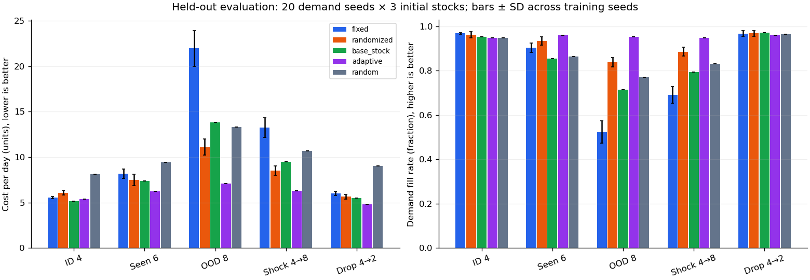

# Управление запасом при сдвиге спроса
Итоговый проект, трек 2. Ярослав Баев (`ysbaev`).

[Открыть ноутбук в Colab](https://colab.research.google.com/github/yarchegit/rl-inventory-research/blob/main/RL_Final_Baev_ysbaev.ipynb)

## Что открыть
`RL_Final_Baev_ysbaev.ipynb` — самодостаточный ноутбук с протоколом, полным кодом, выполненными ячейками, графиками и выводами.
`PROTOCOL.md` — протокол, зафиксированный до обучения.
`results/analysis.md` — численные выводы; `results/episodes.csv` — все эпизоды финальной оценки; `results/primary_effect.csv` — основной парный эффект.

## Запуск
В Google Colab: загрузить ноутбук, выбрать CPU, выполнить все ячейки. При отсутствии Gymnasium первая ячейка установит его. NumPy, pandas, matplotlib входят в Colab; точные версии исходного запуска сохранены в ноутбуке и results/pip-freeze.txt.

Локально:
```sh
python3 -m venv .venv
.venv/bin/python -m pip install -r requirements.txt
.venv/bin/python -m jupyter notebook RL_Final_Baev_ysbaev.ipynb
```
В Jupyter выбрать ядро установленного окружения. Встроенные вычисления CPU; GPU и внешние API не нужны. `research.py` содержит тот же вычислительный код для запуска как Python-скрипта. Полный графический вывод рассчитан на notebook; скрипт также сохраняет PNG.

## Основной результат

После скачка спроса 4→8 рандомизированное обучение снизило издержки на 48,2% относительно обычного обучения. При обычном спросе издержки выросли на 9,4%. Адаптивная эвристика оказалась лучше обоих RL-агентов: превосходство RL над простой стратегией не показано.



## Эксперимент
Табличный Q-learning, обучение только при Poisson(4) против случайного уровня {2,4,6} на эпизод. 3 seed на условие, 360 000 взаимодействий на запуск, одинаковые прочие параметры. Основной тест — внезапный скачок 4→8, которого не было при обучении. Сравнение с фиксированным base-stock (настроен только на ID validation), адаптивной эвристикой и случайными действиями.

Графики: validation learning curves, итоговые метрики, заранее выбранная траектория и карты политики. Полосы — sample SD между тремя training seeds, не доверительные интервалы. Три initial stock на один demand seed зависимы; независимыми повторениями обучения они не считаются.

## Ограничения
Синтетическая модель, один SKU, мгновенная поставка, полный наблюдаемый спрос, скрытый режим и ограниченная память агента. Нет доказательства марковости агрегированного наблюдения и теоретической сходимости Q-learning. Итог — исследование в заданной модели, не рекомендация для реального склада.

## Источники
- Gymnasium: https://gymnasium.farama.org/
- Рассмотренный готовый проект: https://github.com/r2barati/gym-invmgmt


## Файлы и повторный запуск

- `research.py` — среда, проверки, обучение и основная оценка. Запуск: `python research.py`.
- Ноутбук дополнительно содержит анализ начального запаса, нижнего дециля возврата и итоговое обсуждение.
- `results/*.npz` — шесть обученных Q-таблиц.
- `results/*.csv` — исходные результаты и агрегаты; `results/*.png` — графики.
- `results/metadata.json` и `results/pip-freeze.txt` — окружение исходного эксперимента.

Рекомендуется Python 3.11–3.13 (исходный запуск: 3.13.5). Повторный запуск перезаписывает `results/`; для сохранения исходных результатов используйте отдельную копию проекта.

В снимке окружения локальные адреса сборки пакетов заменены на проверенные версии `package==version`.
